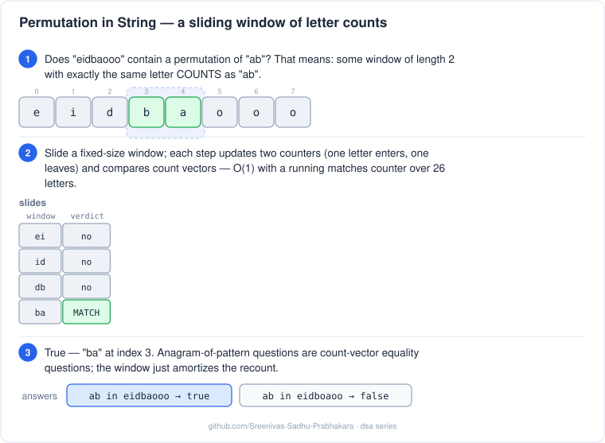

# Permutation in String

> NeetCode 150 · Sliding Window — a fixed-width window plus a matches-out-of-26 counter, adjusted only for the letter entering and the letter leaving. Go, stdlib only, tested.

## Problem

Does some contiguous window of s2 contain exactly the letters of s1 (an anagram of it)? The fixed-size cousin of Minimum Window Substring.

## Approach

A window matches when its 26 letter counts equal s1's. Comparing the arrays per slide costs O(26·n); the refinement tracks `matches` — how many of the 26 counts currently agree — and updates it in O(1) per slide, since only two letters change: the one entering and the one leaving. Each change can flip its letter's agreement in exactly one direction (crossing into equality or out of it), captured by the `== need` / `== need ± 1` cases. `matches == 26` is the hit. The entering/leaving bookkeeping with the final after-loop check (the last window is tested after the loop) is where off-by-ones live, so the "match at the very end" test pins it.

**Complexity:** O(n + m) time, O(26) space.

## Visual walkthrough

Read the picture top to bottom — each numbered frame is one moment of the algorithm
running on this repo's test example.

## Run

    go test ./...   # verify
    go run .        # demo

---

Part of a 275-repo DSA series in Go — Striver's SDE Sheet (dsa-001–191) plus the NeetCode 150 / Blind 75 additions (dsa-192–275), stdlib only, every solution tested. Browse: [`dsa-*` repos](https://github.com/Sreenivas-Sadhu-Prabhakara?tab=repositories&q=dsa-&type=source).
